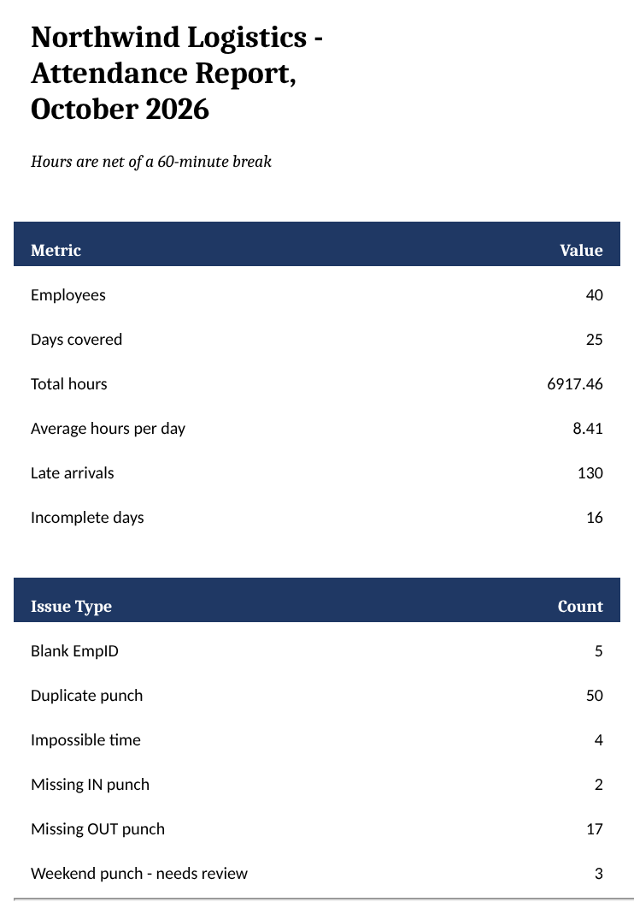
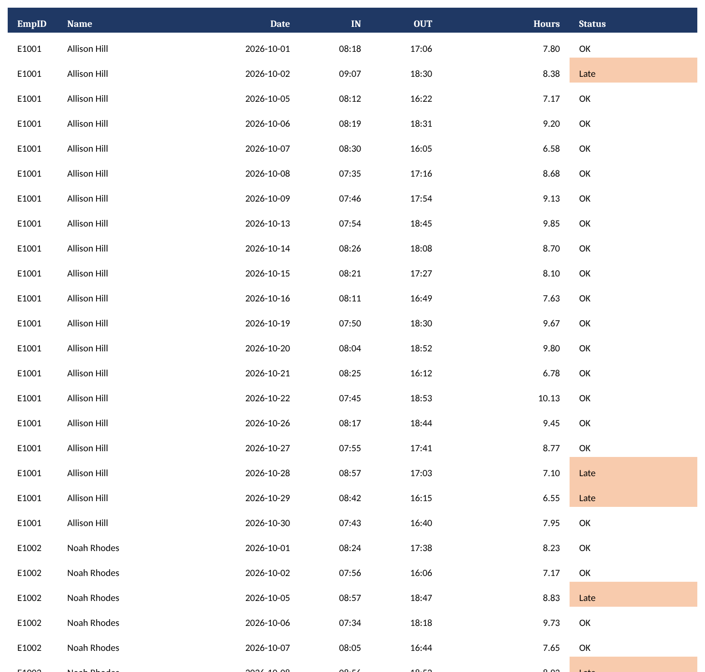

# Time-Clock Cleaner & Excel Attendance Report

Turns a messy employee time-clock export into a clean file you can trust and a ready-to-use Excel attendance report. It also logs every problem it found and what it did about it.

Payroll errors often start with bad punch data: duplicate swipes, missing clock-outs, typos in names, and dates in three different formats. This tool fixes what can be fixed safely and flags the rest for a person to review. Nothing is changed silently.



## Before and after

**Before** (`data/raw_timeclock.csv`): the same employee, on the same day, written two different ways.

```
EmpID,Name,Department,Date,Time,PunchType
E1005,Cristian Santos  ,Drivers,Oct 1 2026,08:54,IN
E1005,CRISTIAN SANTOS  ,Drivers,01/10/2026,18:12,OUT
```

**After** (`output/clean_timeclock.csv`): one name spelling, one date format.

```
EmpID,Name,Department,Date,Time,PunchType
E1005,Cristian Santos,Drivers,2026-10-01,08:54,IN
E1005,Cristian Santos,Drivers,2026-10-01,18:12,OUT
```

**Issues log** (`output/issues_log.csv`): each entry points to the line in the original file.

```
RowNumber,EmpID,Name,Date,Problem,ActionTaken
92,E1005,Cristian Santos,2026-10-02,Duplicate punch,Dropped duplicate row
369,E1025,Matthew Foster,2026-10-07,Blank EmpID,Recovered EmpID from name
569,E1010,Ryan Munoz,2026-10-12,Missing IN punch,Kept OUT punch
```

## What it checks

| Problem | What the cleaner does |
|---|---|
| Names with extra spaces or mixed capitals | Trims and fixes them, for example `  RYAN MUNOZ` becomes `Ryan Munoz` |
| Dates in different formats | Converts `2026-10-01`, `01/10/2026` and `Oct 1 2026` to `2026-10-01`. Drops dates it cannot read |
| Blank employee ID | Fills it in from the name if the name belongs to exactly one employee. Otherwise drops the row and logs it |
| Impossible times such as `25:10` or `13:99` | Drops the row and logs it |
| Duplicate punches | Keeps the first one and drops exact repeats |
| Weekend punches | Keeps them and flags them for review |
| Clock-in with no clock-out, or the reverse | Keeps the punch and flags the day |

## The Excel report

`report.py` builds `output/attendance_report.xlsx` with five sheets:

| Sheet | What it shows |
|---|---|
| Summary | Key numbers for the month and a count of each problem type |
| Employee Hours | One row per employee: days present, complete days, total and average hours, late arrivals, incomplete days |
| Daily Detail | One row per employee per day: first IN, last OUT, hours and status (OK, Late, Incomplete, Weekend - review), color-coded |
| Issues Log | Every problem the cleaner found |
| Settings | Work start time and break length |

All totals are live Excel formulas. If a manager corrects a punch in Daily Detail, the hours, employee totals and summary update on their own. Changing the work start time or break length on the Settings sheet recalculates late arrivals and hours.



## Results on the sample data

The sample file covers 40 employees over October 2026.

| Cleaning | Count |
|---|---|
| Rows read | 1,719 |
| Rows written | 1,665 |
| Problems logged | 81 |
| Duplicate punches removed | 50 |
| Missing clock-outs flagged | 17 |
| Blank IDs recovered | 5 |
| Impossible times removed | 4 |
| Weekend punches flagged | 3 |
| Missing clock-ins flagged | 2 |

| Report | Value |
|---|---|
| Employee-days | 842 |
| Total hours (net of a 60-minute break) | 6,917.46 |
| Average hours per complete day | 8.41 |
| Late arrivals (after 08:30) | 130 |
| Incomplete days | 16 |

## How to run it

You need Python 3.10 or newer.

```bash
python -m venv venv
venv\Scripts\activate        # on macOS or Linux: source venv/bin/activate
pip install -r requirements.txt

python generate_data.py      # optional: rebuilds the sample data
python clean.py
python report.py
```

The cleaner reads `data/raw_timeclock.csv` and writes the clean file and the issues log to `output/`. The report script reads both and writes `output/attendance_report.xlsx`. Each script prints a short summary when it finishes.

If an output file is open in Excel, the scripts ask you to close it instead of crashing.

The report's numbers are Excel formulas, so they appear once the file is opened in Excel or another spreadsheet app. Some file previews (including GitHub's) show those cells as empty.

## Adapting it to your own file

Open `clean.py`. The settings block at the top is the only part you need to touch:

- `INPUT_FILE`: path to your export
- `COLUMNS`: your file's column names, mapped to the ones the script uses
- `PUNCH_IN` / `PUNCH_OUT`: the words your system uses for clock-in and clock-out
- `DATE_FORMATS`: every date format that appears in your file

If a column name is wrong, the script tells you which one before doing anything else.

## About the sample data

All names and records are fake. `generate_data.py` creates them for a fictional company with a fixed random seed, so every run produces the same file. It adds the problems listed above on purpose, so the cleaner has something to find.

## Files

| File | Purpose |
|---|---|
| `generate_data.py` | Builds the messy sample file |
| `clean.py` | The cleaner |
| `report.py` | Builds the Excel attendance report |
| `data/raw_timeclock.csv` | Sample input |
| `output/clean_timeclock.csv` | Cleaned result |
| `output/issues_log.csv` | Every problem found, with the action taken |
| `output/attendance_report.xlsx` | The Excel report |
| `docs/` | Screenshots used in this README |

## License

MIT. See [LICENSE](LICENSE).
